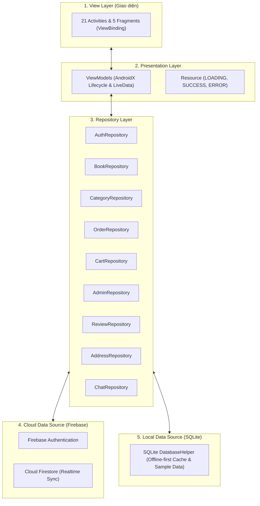

# 📚 BookStore App - Ứng Dụng Bán Sách Trực Tuyến (Android Java)

<p align="center">
  
  
  
  
  
</p>

Ứng dụng thương mại điện tử bán sách trực tuyến hoàn chỉnh trên nền tảng **Android Native (Java 11)**, tuân thủ kiến trúc phân tầng chuẩn **MVVM (Model-View-ViewModel) + Repository Pattern**, kết nối đám mây **Firebase (Authentication, Cloud Firestore)** và hỗ trợ đệm ngoại tuyến với **SQLite (Offline-first & Dual-readiness)**.

Dự án đồ án môn học: **Lập trình thiết bị di động (Android Java)** - Trường Đại học Sư phạm Kỹ thuật TP. Hồ Chí Minh (HCMUTE).

---

## 🌟 Tính Năng Nổi Bật & Mới Nhất

### 🚀 5 Tính Năng Nâng Cấp Xuất Sắc (Mới Bổ Sung)
1. **📖 Trình Đọc Thử Sách Miễn Phí (Sample Book Reader)**:
   - Nút **"📖 ĐỌC THỬ SÁCH MIỄN PHÍ"** trực tiếp trên trang chi tiết sách (`BookDetailActivity`).
   - Tùy chỉnh cỡ chữ đọc sách linh hoạt (`A-` / `A+` từ 12sp đến 32sp).
   - Bộ đổi 3 chế độ nền đọc: **Trắng (Sáng)**, **Sepia (Dịu mắt chống lóa)**, **Đêm (Tối sẫm)**.
   - Trích đoạn tựa & Chương 1 sinh động kèm nút **"MUA SÁCH NGAY"** ghim cố định ở đáy.
2. **🚚 Thanh Tiến Trình Đơn Hàng Đồ Họa (Order Stepper Timeline)**:
   - Hiển thị trực quan 4 nấc trạng thái: `Đã đặt` ➔ `Đã duyệt` ➔ `Đang giao` ➔ `Đã giao`.
   - Vòng tròn icon và đường line đổi màu tự động theo tiến độ đơn hàng; banner màu cam khi đơn bị hủy.
   - Tích hợp đồng bộ ở cả trang Khách hàng (`OrderDetailActivity`) và Admin (`AdminOrderDetailActivity`).
3. **🎟 Hộp Thoại Chọn Mã Giảm Giá 1 Chạm (Voucher Picker BottomSheet)**:
   - Nút **"🎟 Xem danh sách mã giảm giá có sẵn"** tại màn hình Checkout.
   - BottomSheet bo góc hiển thị danh sách thẻ Voucher (`GIAM10`, `GIAM30K`, `BOOKLOVER`, `WELCOME50`) kèm điều kiện đơn hàng.
   - Bấm **"Áp dụng"** tự động điền mã, trừ tiền ngay tức khắc mà không cần gõ phím.
4. **🔔 Thông Báo Thanh Trạng Thái (System Order Status Notifications)**:
   - Notification Channel `bookstore_orders_channel` hỗ trợ Android 8.0+ đến Android 14 (API 34).
   - Khi Admin duyệt, giao, hoàn tất hoặc hủy đơn, hệ thống tự động đẩy thông báo Notification lên Status Bar.
   - Chạm vào thông báo sẽ mở trực tiếp màn hình chi tiết đơn hàng tương ứng.
5. **🌓 Chế Độ Giao Diện Tối / Sáng (Dark / Light Theme Toggle)**:
   - Switch bật/tắt **Chế độ ban đêm (Dark Mode)** ngay trong màn hình Hồ sơ cá nhân.
   - Toàn bộ giao diện chuyển đổi tức thì qua `AppCompatDelegate.setDefaultNightMode`.
   - Ghi nhớ trạng thái vào SharedPreferences và khởi động chuẩn từ Splash Screen.

---

### 👤 Phân Hệ Khách Hàng (User Shopping Flow)
- **Xác thực & Quản lý tài khoản**:
  - Đăng ký, đăng nhập, đổi mật khẩu, quên mật khẩu thông minh (tự đặt lại và thông báo mật khẩu tạm).
  - **Đăng nhập 1 chạm (One-Tap Demo)**: Nút chip điền tự động tài khoản User và Admin.
- **Khám phá & Tìm kiếm thông minh**:
  - Trang chủ với Banner ưu đãi, danh mục thể loại cuộn ngang, sách hot, sách giảm giá sốc.
  - Tìm kiếm thời gian thực theo tên sách, tác giả.
  - Quét mã vạch Barcode ISBN / QR Code bìa sách bằng Camera (ZXing Embedded).
  - BottomSheet lọc và sắp xếp nâng cao: lọc theo khoảng giá (<100k, 100k-200k, >200k), sắp xếp theo giá tăng/giảm, điểm đánh giá cao nhất.
- **Trang chi tiết sách đa năng**:
  - Thông tin xuất bản, điểm sao, hình ảnh sắc nét, giá niêm yết và chiết khấu.
  - Kiểm soát tồn kho thời gian thực: Hiển thị số lượng còn trong kho, tự động gắn nhãn "Hết hàng" và khóa nút mua khi tồn kho bằng 0.
  - Đọc thử sách miễn phí, xem sách cùng tác giả, gửi đánh giá nhận xét.
  - Danh sách yêu thích (Wishlist).
- **Giỏ hàng & Đặt hàng (Checkout)**:
  - Tăng/giảm số lượng có chặn vượt tồn kho, xóa sản phẩm.
  - Chọn voucher từ danh sách có sẵn.
  - Quản lý sổ địa chỉ giao hàng (CRUD địa chỉ, đặt địa chỉ mặc định).
  - Thanh toán linh hoạt: **Tiền mặt (COD)** hoặc **Chuyển khoản VietQR** (quét mã QR ngân hàng tải tự động theo số tiền).
- **Lịch sử đơn hàng & Hóa đơn**:
  - Timeline tiến trình đơn hàng trực quan.
  - Khách hàng có thể hủy đơn khi còn ở trạng thái chờ duyệt (tự động hoàn tồn kho).
  - Đánh giá từng cuốn sách trong đơn hàng đã hoàn tất.
  - Chia sẻ / In hóa đơn mua hàng chi tiết qua các ứng dụng OTT (Zalo, Messenger, Mail,...).
- **Hỗ trợ khách hàng (Live Chat)**:
  - Chat trực tiếp theo thời gian thực với CSKH/Admin, thông báo thanh trạng thái khi có tin nhắn mới.

---

### 👑 Phân Hệ Quản Trị Viên (Admin Management Suite)
- **Dashboard & Phân tích kinh doanh**:
  - Thống kê doanh thu, tổng số đơn, đơn chờ xử lý, số lượng đầu sách và người dùng.
  - **Biểu đồ cột (BarChart)**: Doanh thu theo thời gian.
  - **Biểu đồ tròn (PieChart)**: Tỷ trọng các thể loại sách.
- **Quản lý Kho sách (Inventory Management)**:
  - Hiển thị số lượng tồn kho từng cuốn.
  - Tìm kiếm, thêm mới, sửa giá/mô tả/ảnh/tồn kho, xóa sách có cảnh báo an toàn.
  - Động cơ tồn kho tự động: trừ kho khi đặt hàng, hoàn kho khi hủy đơn.
- **Quản lý Danh mục (Categories)**: Thêm, sửa, xóa danh mục (bảo vệ chống xóa nếu còn sách).
- **Quy trình Duyệt đơn hàng (Order State Machine)**:
  - Lọc theo tab trạng thái hoặc tìm kiếm nhanh theo mã đơn (`#ORD-xxx`), tên khách hàng, SĐT.
  - Duyệt tuần tự: [Duyệt đơn] ➔ [Giao hàng] ➔ [Hoàn tất] hoặc [Hủy đơn].
  - Bắn thông báo Notification đến thiết bị của khách hàng khi đổi trạng thái.
- **Quản lý Người dùng**: Danh sách thành viên, tìm kiếm theo tên/email/sđt, công tắc bật/tắt khóa tài khoản tức thì.
- **CSKH Trực tuyến**: Quản lý các phiên hội thoại của người dùng, phản hồi tin nhắn trực tiếp.

---

## 🏗 Kiến Trúc Kỹ Thuật (Architecture)



---

## 🔑 Tài Khoản Trải Nghiệm & Demo Nhanh

Tại màn hình đăng nhập, có thể bấm trực tiếp vào **Chip Demo 1 chạm** hoặc đăng nhập thủ công:

| Vai trò | Email đăng nhập | Mật khẩu | Quyền hạn |
|---|---|---|---|
| **Quản trị viên (Admin)** | `admin@bookstore.vn` | `admin123` | Quản trị toàn quyền hệ thống |
| **Khách hàng mẫu 1** | `user@gmail.com` | `123456` | Khách mua hàng (đã có sẵn đơn & địa chỉ) |
| **Khách hàng mẫu 2** | `mai.tran@gmail.com` | `123456` | Khách hàng thân thiết |
| **Khách hàng mẫu 3** | `nam.le@gmail.com` | `123456` | Khách hàng |

---

## 🎟 Danh Sách Mã Giảm Giá (Voucher) Thử Nghiệm

Khách hàng có thể chọn trực tiếp từ BottomSheet hoặc nhập thủ công:

| Mã Voucher | Mức Giảm | Điều Kiện Đơn Hàng |
|---|---|---|
| `GIAM10` | Giảm 10% tổng đơn | Đơn từ 100.000 đ |
| `GIAM30K` | Giảm 30.000 đ | Đơn từ 200.000 đ |
| `BOOKLOVER` | Giảm 15% tổng đơn | Đơn từ 150.000 đ |
| `WELCOME50` | Giảm 50.000 đ | Đơn từ 300.000 đ |

---

## 🛠 Công Nghệ & Thư Viện Sử Dụng

- **Hệ điều hành mục tiêu**: Android 8.0 (API 26) - Android 14 (API 34)
- **Ngôn ngữ phát triển**: Java 11
- **Giao diện & Thành phần**: Material Components 3, ViewBinding, Dynamic Dark/Light Theme
- **Xử lý hình ảnh**: Bumptech Glide 4.16.0
- **Biểu đồ thống kê**: MPAndroidChart 3.1.0
- **Quét mã vạch**: ZXing Android Embedded 4.3.0
- **Kiến trúc ứng dụng**: MVVM, AndroidX Lifecycle (ViewModel & LiveData 2.6.2), Repository Pattern, AppExecutors
- **Cơ sở dữ liệu cục bộ**: SQLite (`DatabaseHelper` v4)
- **Dịch vụ đám mây**: Firebase BoM 33.7.0 (`firebase-auth`, `firebase-firestore`, `firebase-storage`)

---

## 🚀 Hướng Dẫn Biên Dịch & Chạy Ứng Dụng

1. **Clone repository về máy**:
   ```bash
   git clone https://github.com/Utabus/BookStoreApp.git
   ```
2. **Khởi động Android Studio**:
   - Chọn **Open** và dẫn tới thư mục `Book_selling_app`.
   - Đợi Gradle Sync hoàn tất.
3. **Kiểm tra biên dịch qua Terminal**:
   ```powershell
   cd Book_selling_app
   .\gradlew assembleDebug
   .\gradlew testDebugUnitTest
   ```
4. **Chạy ứng dụng**:
   - Chọn thiết bị máy ảo Android Emulator hoặc điện thoại thật qua kết nối cáp USB/WiFi.
   - Nhấn **Run (Shift + F10)**.
